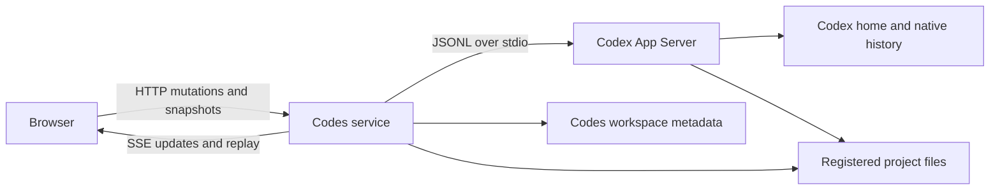

# Architecture

Codes runs a React web client and one Node.js workspace service. The service adapts the installed Codex App Server, owns browser access, and journals Codes operations. Codex owns native execution and conversation history.

## Chosen route

The service uses native structured messages for turns, reviews, permissions, approvals, questions, and history. It checks the installed protocol before opening a runtime. The browser can close or reconnect without taking ownership of the process.

## Responsibilities

| Layer             | Owns                                                                                   | Entry points                                                                                                                                                                                                                  |
| ----------------- | -------------------------------------------------------------------------------------- | ----------------------------------------------------------------------------------------------------------------------------------------------------------------------------------------------------------------------------- |
| Native adapter    | Protocol discovery, runtime epoch, JSONL I/O, acknowledgement deadlines                | [protocol](../src/codex/protocol.ts), [driver](../src/codex/driver.ts), [RPC](../src/codex/rpc.ts)                                                                                                                            |
| HTTP and events   | Host/Origin/session checks, feature routes, bounded bodies, snapshots and replay       | [HTTP](../src/server/http.ts), [routes](../src/server/routes), [events](../src/server/events.ts)                                                                                                                              |
| Execution         | Verified project context, native dispatch, terminal correlation and durable receipts   | [service](../src/server/service.ts), [store](../src/server/store.ts)                                                                                                                                                          |
| Interactions      | Runtime-bound approval and blocking question callbacks, durable asynchronous questions | [native interactions](../src/server/native-interactions.ts), [async questions](../src/server/async-questions.ts)                                                                                                              |
| History and files | Scheduled native reads, working-tree and document previews, bounded project writes     | [read scheduler](../src/server/conversation-reads.ts), [history](../src/server/conversation-history.ts), [file management](../src/server/project-file-management.ts), [document previews](../src/server/document-previews.ts) |
| Web client        | Drafts, responsive layout, active feed, and delivery controls                          | [workspace](../src/web/main.tsx), [timeline](../src/web/useConversationTimeline.ts), [delivery](../src/web/useMessageDelivery.ts), [layout](../src/web/useWorkspaceLayout.ts)                                                 |

## Execution and recovery

1. The browser allocates an operation ID. Codes records the operation before native dispatch and uses that ID as `clientUserMessageId` for applicable turns.
2. An identical retry of the same ID reads the existing operation receipt. A different request with the same ID is rejected. Sends and native reviews share an execution lease per conversation.
3. Native acceptance records the turn identity. The lease clears when a matching terminal event or confirmed history result proves the outcome. Stop requests interruption and waits for terminal evidence.
4. A lost acknowledgement or dead runtime can leave the result unknown. **Check result** reconciles the original operation against recent native history. Restart preserves uncertainty and expires callbacks from the previous runtime.

Approvals and blocking questions are scoped to the live runtime epoch and request ID. Multiple signed-in browsers share their pending state. Asynchronous questions have their own persistent records. [Interaction behavior](conversation-workflow.md#answer-codex-questions)

## Queued messages and native branches

The persisted queue and dispatcher live in [conversation-queue.ts](../src/server/conversation-queue.ts) and [message-queue.ts](../src/server/message-queue.ts). Entries carry text, attachment references, task mode, and configuration evidence. Automatic dispatch verifies readiness and the applicable Codex configuration. Native acceptance removes the queue entry while the task's receipt remains. Restart or uncertainty holds waiting work.

Native fork creates a conversation through a completed turn. Branch identity and its operation receipt are separate from task execution receipts. The new conversation shares the project's current files. [Queue and fork controls](conversation-workflow.md)

## Rendering and resource limits

The browser coalesces streaming updates and renders completed messages as Markdown. Recent transcript views can appear while a fresh snapshot and SSE connection load. The cache holds transcript data. The service supplies current receipts, approval state, and execution context.

| Resource                                 | Current bound                                                        |
| ---------------------------------------- | -------------------------------------------------------------------- |
| Native JSONL frame                       | 16 MiB                                                               |
| Concurrent native history reads          | Two, including up to one background pagination read                  |
| Pending native history reads             | 24, with a five-second admission wait                                |
| Native history page                      | Up to 12 turns, 240 mapped messages, and 2 MiB of mapped text        |
| Browser historical window and live cache | Three retained pages and a separate live cache of up to 240 messages |
| Recently opened conversation cache       | Six views, up to 240 messages and 512 Ki characters per view         |
| Event replay                             | 512 events or 1 MiB                                                  |
| Pending queue entries                    | Ten per conversation and 100 per workspace                           |

The read scheduler shares identical requests and stops fetching subsequent native pages after the last reader disconnects. A recognizable oversized history response can fail its request without closing the connection. An invalid or unidentifiable frame tears down the shared connection and leaves unfinished work protected. Legacy history uses bounded full-item turn pages. Paginated history reads turn metadata and hydrates items separately. Evicted browser pages remain accessible through native cursors.

Directory listings and small text previews share an estimated 2 MiB per signed-in tab, with up to eight entries of each kind and a 30-second freshness window. Codes refreshes cached reads in the background and requires current file data before attaching it. A matching Word file version lets the server skip document extraction. Images and PDF data load on demand through their existing preview paths.

The session sidebar retains one first page each for Active and Archived for 30 seconds. Search results and additional pages are fetched on demand. Codex model and mode catalogs are shared across tabs for up to 60 seconds per runtime. Account and runtime changes invalidate those catalogs. Effective execution configuration still comes directly from Codex.

A tab remembers up to 100 conversation reading anchors using a turn ID and scroll offset. An anchor on an older page can fetch that page again through its native cursor. A missing anchor falls back to the latest messages.

Other budgets are documented where they apply. [Files and previews](conversation-details.md#preview-documents-images-and-html) · [Attachments](image-attachments.md#supported-inputs-and-limits) · [Browser recovery](operations.md#when-the-page-disconnects)

## Native sessions and working directories

The session list pages native metadata without loading transcripts. Snapshots use the native thread working directory to establish file and execution context. A missing directory keeps history readable while directory actions wait for recovery. [Working directories](conversations.md#working-directories)

SQLite schema 6 stores directory scopes, preferences where applicable, receipts, queues, and attachment metadata. The native history and CLI login belong to the Codex home. [Persistent state](operations.md#persistent-state)

## Compatibility and trust

The [CI workflow](../.github/workflows/checks.yml) checks native metadata on CLI 0.166.0, 0.167.0, 0.168.0, and 0.172.0. The installed runtime's generated schema determines required and optional capabilities. Missing optional behavior is surfaced in the interface. [Development checks](development.md#checks)

Codes is a single-owner service. Its HTTP access rules protect workspace entry, while native sandbox and approval rules govern execution. Project writes validate registered paths and server-side permissions. Explicit out-of-scope previews are read-only and show a warning. [Access and hosting](operations.md#network-and-access) · [Files and changes](conversation-details.md)

## Source references

- [Codex App Server](https://learn.chatgpt.com/docs/app-server)
- [Codex CLI](https://learn.chatgpt.com/docs/codex/cli)
- [Codex IDE extension](https://learn.chatgpt.com/docs/codex/ide)
