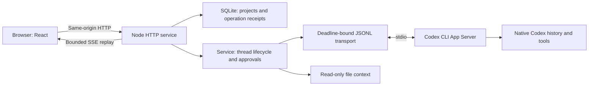

# Architecture

codes is a single-owner Linux web application. Its execution boundary is the installed Codex CLI App Server. The browser owns presentation; a long-lived Node service owns protocol connections and operation receipts.

## Chosen route

| Route                                   | Strength                                                                | Cost                                                                                                            | Decision                            |
| --------------------------------------- | ----------------------------------------------------------------------- | --------------------------------------------------------------------------------------------------------------- | ----------------------------------- |
| Wrap interactive CLI output in a PTY    | Quick terminal mirroring                                                | Terminal rendering, prompt parsing, unstable approval detection; still needs reconnection and process ownership | Not selected for the main interface |
| Use `codex app-server` structured JSONL | Native thread/turn identities, streamed events, approvals, history APIs | Protocol compatibility must be pinned and tested                                                                | Selected                            |

The official [App Server documentation](https://learn.chatgpt.com/docs/app-server) describes the protocol also used by IDE clients. Reusing that execution interface avoids reproducing agent behavior. It does **not** by itself solve browser rendering, buffering, duplicate dispatch, or reconnect races; those belong to codes.

## Responsibilities

- `src/codex/rpc.ts`: framing, UTF-8 boundaries, response correlation, write limits, and acknowledgement deadlines.
- `src/codex/driver.ts`: exact CLI version check, initialization, one child process, shutdown, and runtime epoch.
- `src/server/service.ts`: project ownership, bounded native reads, execution leases, approvals, and reconciliation.
- `src/server/store.ts`: SQLite metadata and durable operation receipts. Native conversation text remains in Codex history; a pending prompt is temporarily retained for recovery.
- `src/server/events.ts`: bounded replay ring and slow-client disconnection.
- `src/server/http.ts`: authenticated same-origin API, SSE, and static assets.
- `src/web/feed.ts`: snapshot/replay handshake, finite reconnect backoff, and stale-navigation cancellation.
- `src/web/main.tsx`: UI, stable message identities, coalesced deltas, and local draft handling.

## Execution and recovery

1. The browser allocates a UUID and records it locally before sending.
2. SQLite records the operation before the server calls `turn/start`. A partial unique index permits one unfinished send per conversation.
3. The same UUID is passed as native `clientUserMessageId`. Repeating an ID with identical input returns its receipt; reusing it for different input or another conversation is rejected.
4. An acknowledgement records the turn ID. A native terminal event releases the execution lease only when its turn or client message identity matches.
5. A timeout or runtime loss yields **unknown**, rather than an automatic resend. **Check result** reads native history and correlates the exact client message ID to a terminal turn.
6. A service restart retains unresolved operations as unknown. It cannot reconstruct a live approval callback from a dead child process; those approvals expire.

The browser disconnecting does not own the CLI lifetime. A server stop does terminate the child. An `interrupt` acknowledgement only means interruption was requested; the UI waits for the terminal event before displaying Stopped.

Approvals are addressed by the runtime epoch and native request ID. Concurrent clients share one action state. Only one response can transition a pending action. Permission grants are restricted to the current turn; permanent policy amendments are not exposed. Unsupported interaction methods receive an explicit rejection.

## Rendering and resource limits

Streaming deltas update memory and an event buffer, not a database row per token. The UI coalesces deltas at 32 ms and renders an active answer as plain text. Completed messages use memoized Markdown. An idle view subscribes to project summaries without receiving other conversations’ text. Evicting an idle cached thread unsubscribes its native event subscription, allowing the CLI to unload it after its own grace period. Opening a conversation fetches the latest 12 turns; earlier turns are requested separately.

| Resource                             | Preview limit                                          |
| ------------------------------------ | ------------------------------------------------------ |
| CLI line                             | 4 MiB                                                  |
| Outstanding CLI requests             | 64                                                     |
| CLI input buffer                     | 1 MiB                                                  |
| Normal RPC acknowledgement           | 30 seconds                                             |
| Complete history read budget         | 25 seconds after starting the read                     |
| Browser HTTP deadline                | 35 seconds                                             |
| HTTP request body / context file     | 256 KiB each                                           |
| Combined prompt and selected context | 100 KB                                                 |
| Single displayed item                | 128 Ki characters                                      |
| History page                         | 12 turns, at most 240 mapped items / 2 MiB mapped text |
| Browser message window               | 240 messages                                           |
| Cached conversations                 | 20, evicting idle conversations                        |
| Concurrent unfinished conversations  | 4, including unknown operations                        |
| Event replay                         | 512 events / 1 MiB                                     |
| Browser SSE connections              | 32                                                     |
| Slow-client queued output            | 512 KiB before disconnect                              |
| Completed/failed operation receipts  | 30 days                                                |

Oversized history pages produce an explicit limit error. Very large native tool results can exceed the JSONL frame limit and close the runtime; use the CLI to inspect such conversations. The preview is designed around a small working set, not unlimited logs. Limits are implementation constraints, not measured throughput claims.

## Compatibility and trust

Supported protocol baseline: **Codex CLI 0.167.0**. Protocol behavior was checked against generated schemas and a metadata-only native smoke test, followed by an isolated live read/write/interrupt pilot. The metadata check exposed lazy thread materialization: `thread/turns/list` reports a specific error before the first user message. The adapter treats only that pinned-version error as empty history.

An independent simulator exercises protocol timing and failure paths, but does not prove that every live Codex tool, account policy, permission request, or model event behaves as expected. Basic live read/write/interrupt acceptance passed; real prompting policies and broader tool variants remain separate gates.

The workspace token grants access to the configured owner's projects and execution authority. Project paths are canonicalized; the file browser refuses hidden paths, traversal, and symlinks escaping the project. Files are exposed read-only through the browser. This is not isolation against a malicious local process modifying the filesystem concurrently, or against tools authorized by the owner to execute on the host.

The implementation intentionally omits multi-tenancy, a browser terminal, automatic deployment, automatic Git commits, branch/worktree orchestration, and a second editable history store.

## Source references

- [Official App Server protocol and lifecycle](https://learn.chatgpt.com/docs/app-server)
- [Official Codex CLI](https://learn.chatgpt.com/docs/codex/cli)
- [Official Codex IDE extension](https://learn.chatgpt.com/docs/codex/ide)

The repository implementation and tests define codes-specific API and UI behavior. References explain the underlying Codex interface; they do not certify this application.
