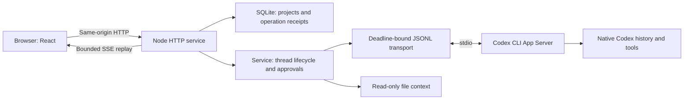

# Architecture

codes is a single-owner Linux web application. Its execution boundary is the installed Codex CLI App Server. The browser owns presentation; a long-lived Node service owns protocol connections and operation receipts and durable message queues.

## Chosen route

| Route                                   | Strength                                                                | Cost                                                                                                            | Decision                            |
| --------------------------------------- | ----------------------------------------------------------------------- | --------------------------------------------------------------------------------------------------------------- | ----------------------------------- |
| Wrap interactive CLI output in a PTY    | Quick terminal mirroring                                                | Terminal rendering, prompt parsing, unstable approval detection; still needs reconnection and process ownership | Not selected for the main interface |
| Use `codex app-server` structured JSONL | Native thread/turn identities, streamed events, approvals, history APIs | Protocol compatibility must be pinned and tested                                                                | Selected                            |

The official [App Server documentation](https://learn.chatgpt.com/docs/app-server) describes the protocol also used by IDE clients. Reusing that execution interface avoids reproducing agent behavior. It does **not** by itself solve browser rendering, buffering, duplicate dispatch, or reconnect races; those belong to codes.

## Responsibilities

- `src/codex/rpc.ts`: framing, UTF-8 boundaries, response correlation, write limits, and acknowledgement deadlines.
- `src/codex/driver.ts`: exact CLI version check, initialization, one child process, shutdown, and runtime epoch.
- `src/server/service.ts`: project ownership, bounded native reads, execution leases, approvals, and reconciliation.
- `src/server/store.ts`: SQLite metadata and durable operation receipts. Native conversation text remains in Codex history; a pending prompt is temporarily retained for recovery.
- `src/server/project-context.ts`: asynchronous registered-directory health checks, separate from native history and permissions.
- `src/web/project-navigation.ts`: bounded browser project-view memory; execution/settings remain server-owned.
- `src/server/events.ts`: bounded replay ring and slow-client disconnection.
- `src/server/http.ts`: authenticated same-origin API, SSE, and static assets.
- `src/web/feed.ts`: snapshot/replay handshake, finite reconnect backoff, and stale-navigation cancellation.
- `src/web/main.tsx`: UI, stable message identities, coalesced deltas, and local draft handling.

## Execution and recovery

1. The browser allocates a UUID and records it locally before sending.
2. SQLite records the operation before the server calls `turn/start`. A partial unique index permits one unfinished send per conversation.
3. The same UUID is passed as native `clientUserMessageId`. Repeating an ID with identical input returns its receipt; reusing it for different input or another conversation is rejected.
4. An acknowledgement records the turn ID. A native terminal event releases the execution lease only when its turn or client message identity matches.
5. A timeout or runtime loss yields **unknown**, rather than an automatic resend. **Check result** reads native history and correlates the exact client message ID to a terminal turn.
6. A service restart retains unresolved operations as unknown. It cannot reconstruct a live approval callback from a dead child process; those approvals expire.

The browser disconnecting does not own the CLI lifetime. A server stop does terminate the child. An `interrupt` acknowledgement only means interruption was requested; the UI waits for the terminal event before displaying Stopped.

Approvals are addressed by the runtime epoch and native request ID. Concurrent clients share one action state. Only one response can transition a pending action. Permission grants are restricted to the current turn; permanent policy amendments are not exposed. Unsupported interaction methods receive an explicit rejection.

## Queued messages and native branches

A separate queue controller serializes waiting messages through the existing task-dispatch path. SQLite retains payloads, order, controls, and mutation identities; the browser subscribes to bounded previews. Native approvals remain independent callbacks. Uncertain dispatches hold the queue, and restart never automatically replays work. A successful terminal receipt can advance the queue; stop, failure, or decline pauses it for explicit review. Readiness is checked again after asynchronous native reads.

Native `thread/fork` copies conversation context through a completed turn. Branch result IDs are journaled separately from execution receipts, and source metadata is scoped to the registered project. A branch uses the same current files and receives a fresh read-only configuration and empty queue. Codes does not implement file rollback or Git worktrees through this control. See [workflow behavior](conversation-workflow.md).

## Rendering and resource limits

Streaming deltas update memory and an event buffer, not a database row per token. The UI coalesces deltas at 32 ms and renders an active answer as plain text. Completed messages use memoized Markdown. An idle view subscribes to project summaries without receiving other conversations’ text. Evicting an idle cached thread unsubscribes its native event subscription, allowing the CLI to unload it after its own grace period. Opening a conversation fetches up to the latest 12 turns; earlier turns are requested separately.

| Resource                             | Preview limit                                          |
| ------------------------------------ | ------------------------------------------------------ |
| CLI line                             | 16 MiB                                                 |
| Outstanding CLI requests             | 64                                                     |
| CLI input buffer                     | 1 MiB                                                  |
| Normal RPC acknowledgement           | 30 seconds                                             |
| Complete history read budget         | 25 seconds after starting the read                     |
| Browser HTTP deadline                | 35 seconds                                             |
| HTTP request body / context file     | 256 KiB each                                           |
| Combined prompt and selected context | 100 KB                                                 |
| Single displayed item                | 128 Ki characters                                      |
| History page                         | 12 turns, at most 240 mapped items / 2 MiB mapped text |
| Browser live message cache           | 240 messages                                           |
| Recently viewed conversations        | 6 views, up to 240 messages / 512 Ki characters each   |
| Cached conversations                 | 20, evicting idle conversations                        |
| Concurrent unfinished conversations  | 4, including unknown operations                        |
| Event replay                         | 512 events / 1 MiB                                     |
| Browser SSE connections              | 32                                                     |
| Slow-client queued output            | 512 KiB before disconnect                              |
| Pending queued deliveries            | 10 per conversation / 100 workspace-wide               |
| Queue event/snapshot text preview    | 2,000 characters per message; full payload retained    |
| Pending steering previews            | 10 entries per conversation / 2,000 characters each    |
| Completed/failed operation receipts  | 30 days                                                |

Native turn lists omit item bodies; item hydration requests one item at a time so large results do not accumulate into a single RPC response. The JSONL decoder accumulates fragments within its 16 MiB frame budget and concatenates once per complete frame. These transport limits are separate from the bounded browser representation.

The historical display retains three native pages independently of the live cache; the 240-item budget is not a lifetime history limit. Pages evicted at either edge remain reachable through native cursors.

Switching back to a recent conversation displays its cached transcript while the browser starts a fresh snapshot and event subscription. The cache is local to the page and clears at sign-out or session expiration. Queued work, approvals, project context, and settings continue to load from the server.

History pages automatically use fewer turns when their combined items exceed the display budget. A single oversized turn still produces an explicit limit error. Very large native tool results can exceed the JSONL frame limit and close the runtime; use the CLI to inspect such conversations. The preview is designed around a small working set, not unlimited logs. Limits are implementation constraints, not measured throughput claims.

Legacy Codex histories use native `thread/turns/list` with full items and a one-turn initial page. Paginated histories retain separate item hydration. Both paths apply the same display budgets and cursor handling; Codes never requests an eager full-thread read to import old conversations. This follows the [native history contracts](https://learn.chatgpt.com/docs/app-server#list-thread-items), where item pagination requires a supporting thread store. Registration reuses native IDs and files; it does not convert or duplicate transcripts.

## Project and conversation context

SQLite schema 5 retains project registrations and conversation associations. Browser navigation stores at most 20 recent project views, separately from conversation drafts and server-backed settings. The native conversation header validates ownership; selected snapshots add bounded project/directory metadata, and conversation file APIs derive their directory from the thread ID. Project-level file APIs remain compatible for uncreated drafts and older callers.

Directory health uses asynchronous filesystem checks. Missing or inaccessible directories do not erase history; new execution and filesystem access fail explicitly. Queues pause before claiming their next item. Existing configured registrations survive service startup with a missing path. These checks preserve directory context and native permissions rather than adding another tool authorization engine. See [project/conversation behavior](session-navigation-proposal.md).

## Compatibility and trust

Codes discovers the installed App Server methods and fields from the CLI's generated protocol schema, then validates the stdio handshake. The native compatibility matrix tests CLI 0.166.0, 0.167.0, 0.168.0, and 0.172.0. Other versions are accepted when they expose the required execution, approval and history contracts. Missing optional branch, review or turn-speed capabilities are reported and gated. Versions with full-turn history can use bounded legacy pages. The [IDE alignment audit](ide-parity.md) records the earlier protocol baseline.

Conversation history schedules at most two native reads, including at most one background pagination request. Identical reads share work. Disconnecting the last reader stops subsequent native pages. Oversized JSONL replies identified by a known history request ID fail that read. Unknown or malformed frames still fail the connection to protect execution receipts and approval callbacks.

An independent simulator exercises protocol timing and failure paths, but does not prove that every live Codex tool, account policy, permission request, or model event behaves as expected. Basic live read/write/interrupt acceptance passed; real prompting policies and broader tool variants remain separate gates.

The workspace token grants access to the configured owner's projects and execution authority. The read-only file browser hides dotfiles by default and supports an explicit opt-in. Paths are canonicalized, with traversal and escaping symlinks denied. Nested Codes and Codex data directories are excluded from the project view. A local process can still modify the filesystem concurrently, and authorized tools can execute on the host.

The implementation intentionally omits multi-tenancy, a browser terminal, automatic deployment, automatic Git commits, branch/worktree orchestration, and a second editable history store.

## Source references

- [Official App Server protocol and lifecycle](https://learn.chatgpt.com/docs/app-server)
- [Official Codex CLI](https://learn.chatgpt.com/docs/codex/cli)
- [Official Codex IDE extension](https://learn.chatgpt.com/docs/codex/ide)

The repository implementation and tests define codes-specific API and UI behavior. References explain the underlying Codex interface; they do not certify this application.
